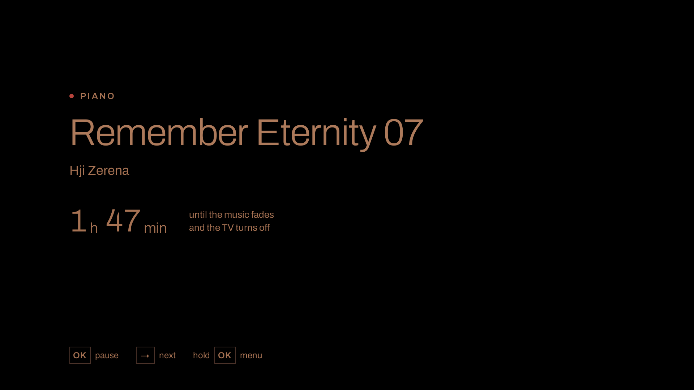
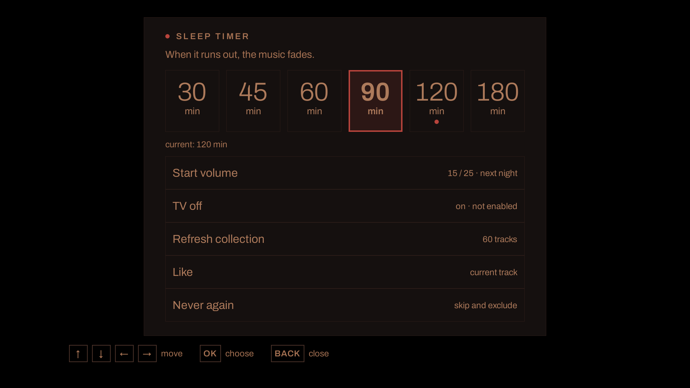
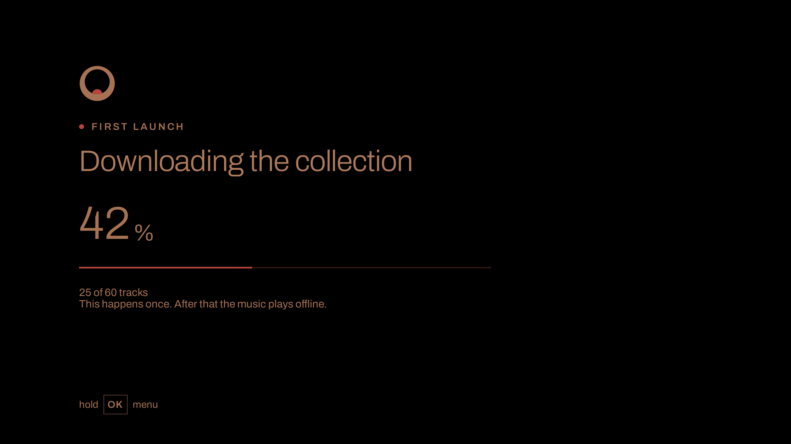

# Dremla

Bedtime music for an Android TV box. One press on the remote starts soft ambient or calm piano from an offline collection, the picture goes black after a few seconds, and the music fades out when the timer ends (two hours by default). Nothing restarts on its own: not after the fade, not when the box wakes up, not in the morning.

Dremla is for anyone who falls asleep to music on a TV and wants only that: no catalogue to browse, no account, no screen glowing at night, no app that comes back by itself.

## Screenshots

The night screen, the sleep-timer menu and the first launch. These are the golden images from the UI test suite, rendered at 1920×1080.







## Download

Releases are published on [GitHub Releases](https://github.com/BeFeast/dremla/releases/latest). Each release has two assets: `dremla-<version>.apk` and `SHA256SUMS`.

Check the APK before installing it:

```bash
sha256sum -c SHA256SUMS
```

Every release is signed with the same certificate. Its SHA-256 fingerprint, and the digest of the current release APK, are pinned in [delivery/release-lock.json](delivery/release-lock.json):

- Signing certificate SHA-256: `68aae0414c83517bf5d6b0326e0731d61a904ba37049bef7cec8fa748a2e6687`
- `dremla-0.1.0.apk` SHA-256: `af54379cc8bc3171d687b139f81d263deab7f3f60d883b50210f430757b67ea9`

To compare the certificate yourself, run `apksigner verify --print-certs dremla-<version>.apk` (from Android build-tools) and read the signer's SHA-256 digest. An APK signed with a different certificate is not a Dremla release.

## Install on an Android TV box

Dremla is not in an app store; it is sideloaded. It needs Android TV 9 or newer (API 28). It has been tested on a 32-bit armeabi-v7a Android TV box running Android TV 14.

1. On the box, allow installs from unknown sources. On most boxes this is under Settings → Apps → Security & restrictions; some keep it under Developer options, which appear after selecting the build number several times in About.
2. Install the APK in one of two ways:
   - from a computer that is already connected to the box with `adb` (USB debugging turned on in Developer options):

     ```bash
     adb install -r dremla-<version>.apk
     ```

   - or copy the APK to a USB stick, open it on the box with a file manager app and confirm the installation.
3. Dremla appears in the launcher. Start it once with network available: the first launch downloads the collection, after that it plays offline.
4. Optional: for the box to go to sleep after the music fades, enable the Dremla accessibility service (it is listed as "TV off") in Settings → Accessibility. Without it the screen stays black at the end of the night and nothing more happens; the menu shows which of the two you have.

A newer version installs over the previous one the same way and keeps the settings, likes and the downloaded collection.

## How it works

- **One press.** Starting Dremla from the launcher plays a random track from the selection with a 30-second fade-in, at the start volume set in the menu (15 of 25 by default). Only a launcher start plays music; resume, wake, boot or a restarted process never do.
- **Offline.** The first launch downloads the selection once. Every file is checked against its SHA-256; an interrupted download continues where it stopped. After that Dremla needs no network. "Refresh collection" in the menu fetches new tracks when you ask for them and keeps the old ones playing if the download fails.
- **Black screen.** About ten seconds after start the picture becomes pure black and stays black. The music continues; no clock, no artwork, no glow.
- **Timer and fade.** 30, 45, 60, 90, 120 or 180 minutes, remembered for the next night. The last ten minutes fade smoothly to silence, then playback stops. With "TV off" on (the default) the box goes to sleep and, if the TV follows HDMI-CEC, the TV goes to standby with it.
- **Nothing restarts.** Waking the box, a reboot or a media key in the morning never starts music. If the system kills the app at night, it does not come back playing.
- **No repeats.** Tracks play in a shuffle bag: nothing repeats until the whole selection has played. "Never again" removes a track for good, "Like" is remembered too; both survive restarts, reboots and refreshes.
- **Private.** No account, no telemetry, no analytics, no crash reporting. The only network traffic is the collection download. Settings never leave the box.

Remote keys:

| Key | Action |
|---|---|
| OK | Pause / resume |
| Right | Next track |
| Hold OK | Open the menu: timer, start volume, TV off, refresh collection, like, never again |
| Back | Close the menu |
| Volume and mute | Stay with the system, as on any other app |

## Build

JDK 17 and an Android SDK with platform 34 and build-tools 34.0.0 (`ANDROID_HOME`) are required.

```bash
DREMLA_OUTCOME_SCOPE=repo scripts/verify-outcome.sh
```

runs the clean build, unit tests, lint, golden scenes, APK inspection, the hygiene check, the forbidden-API check and the brand-kit port check. The toolchain pins (AGP, Gradle, Kotlin, Compose for TV, Media3) are listed in [AGENTS.md](AGENTS.md).

## Development and feedback

This GitHub repository is a read-only mirror; development, issues and releases happen on BeFeast's own forge. Bug reports are welcome in GitHub Issues here; accepted ones are moved to our internal tracker. Pull requests are not merged on GitHub.

- Product contract: [docs/PRD.md](docs/PRD.md)
- Design contract: [docs/design-contract.md](docs/design-contract.md)
- Agent rules: [AGENTS.md](AGENTS.md)
- Build, CI and golden scenes: [docs/ci.md](docs/ci.md)
- Brand-kit port and its SHA-256 check: [docs/kit-port.md](docs/kit-port.md)
- Playback service, MediaSession and one-press autoplay: [docs/playback.md](docs/playback.md)

## License

[MIT](LICENSE). Bundled fonts (Archivo, Inter) are under the SIL Open Font License 1.1. Collection audio is CC0 or public-domain mark; the app downloads it at runtime and it is never stored in this repository.
